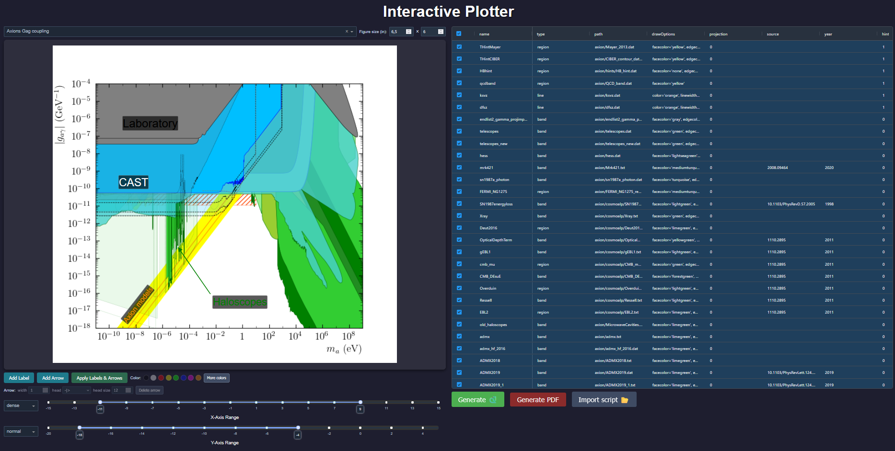

# Interactive Plotter 🌌📱

A Dash web app for interactively building and exporting publication-quality physics limit plots (axion and WIMP parameter space) powered by the [axionlimits](https://github.com/iaxo/axion-limits) library.

[](docs/interactive_plotter_Gag.png)

## Requirements ⚙️

- Python 3.9+
- `axionlimits` python package (see [axionlimits installation guide](../../README.md#installation-%EF%B8%8F) for more details).
- `dash`, `dash-ag-grid`:
    ```bash
    cd apps/interactive_plotter
    pip install -r requirements.txt
    ```

## Running the app 👨‍💻

```bash
cd apps/interactive_plotter
python app.py
```

Then open your browser at [http://127.0.0.1:8050](http://127.0.0.1:8050).

### From remote server 🌐🖥️

You can run the app from a remote server too by SSH Port Forwarding. For that, run on your local machine
```bash
ssh -L 8050:localhost:8050 -N -f -l username remote-server-ip
```

---

## Interface overview 🔍

### Plot type selector

Use the dropdown at the top-left to choose what kind of limit plot to display:

| Option | Description |
|---|---|
| **Axions Gag coupling** | Axion–photon coupling $g_{a\gamma}$ vs. mass |
| **Axions Cag coupling** | Axion–photon coupling $C_{a\gamma}$ variant |
| **WIMPS SI coupling** | WIMP spin-independent cross-section vs. mass |

Switching plot type also resets the axis sliders and the figure size to sensible defaults for that plot.

### Figure size

The **Figure size (in)** inputs next to the plot type selector set the matplotlib figure width and height in inches (`figx`, `figy`). The plot is regenerated when you press **Enter** or leave the input.

### Experiment table (right panel)

The AG Grid table lists all available experiments from the database for the selected plot type.

- **Select rows** by clicking the checkbox on the left of each row, or anywhere else on the row (except the `drawOptions` cell). Each click toggles only that row and keeps the rest of the selection. Selected experiments are drawn on the plot.
- The **`drawOptions`** column is editable: click a cell to modify the drawing style for that experiment (e.g. colour, fill, line style). Changes are reflected in the plot on the next update.

### Axis range sliders

Two `RangeSlider` controls below the plot set the axis limits on a **log₁₀ scale**:

- **X-Axis Range** — sets $\log_{10}(m_a)$ (axion mass in eV) or $\log_{10}(m_\chi)$ (WIMP mass in GeV).
- **Y-Axis Range** — sets $\log_{10}$ of the coupling or cross-section.

You can also type values directly into the numeric inputs on either side of each slider.

### Tick density dropdowns

At the left of each axis slider, there is a dropdown to control tick density for that axis:
Accepted values are:

- **`normal`**: one tick every factor 10.
- **`dense`**: one tick every factor 100.

---

## Draggable labels 🔤

Labels can be placed freely on top of the plot image.

### Adding labels

Click **Add Label** to create a new text label. It appears in the top-left corner of the plot. You can add as many as you like.

### Editing a label

**Double-click** a label to make it editable. Type the desired text, then click outside or press **Enter** to confirm.

### Moving a label

**Click and drag** a label to reposition it anywhere over the plot.

### Resizing (font size)

Hover over a label and scroll the **mouse wheel** (without holding any modifier key) to increase or decrease the font size (range: 6–72 px).

### Rotating a label

Hover over a label and scroll the **mouse wheel while holding Shift** to rotate it in 2° steps.

### Changing label color

Use the color swatches below the plot to set the color of the **currently selected** label (or arrow), or click **More colors** to open a full color picker and enter any hex/RGB value.

### Applying labels to the exported plot

The labels shown in the browser are overlaid on the plot image. To bake them into the actual matplotlib figure (so they appear in exports), click **Apply Labels & Arrows**. The plot will regenerate with all labels placed at their current browser positions, sizes, rotations, and colors.

---

## Draggable arrows ↗️

Arrows (or plain lines) can be drawn on top of the plot in the same way as labels.

- **Add Arrow** creates a new arrow in the middle of the plot and selects it.
- **Click** an arrow to select it: its two ends show round handles.
- **Drag a handle** to move that end, or **drag the arrow body** to move the whole arrow.
- With an arrow selected, the **Arrow** toolbar below the color palette sets:
    - **width**: line width in points.
    - **head**: arrow head style, using matplotlib's names: `-` (no head, a plain line), `->`, `-|>`, `<-`, `<|-`, `<->`, `<|-|>`.
    - **head size**: size of the head in points (matplotlib's `mutation_scale`).
- The **color** palette (and **More colors**) colors the selected arrow.
- **Delete arrow** (or the **Delete**/**Backspace** key) removes the selected arrow.

Click **Apply Labels & Arrows** to draw the arrows in the matplotlib figure. They are added as `matplotlib.patches.FancyArrowPatch` objects in data coordinates, and the exported python script includes them.

---

## Importing a script 📂

**Import script 📂** loads an existing `axionlimits` plotting script (e.g. the ones in [myPlottingScripts](../../myPlottingScripts)) so you can continue editing that plot in the app. The script is run on the server with the plot showing and saving disabled (no files are written), and the following is taken from the last `AxionGagPlot`/`WimpPlot` it creates:

- Plot type (`AxionGagPlot` with `plotCag=False`/`True`, or `WimpPlot`), axis limits, figure size and tick options.
- Experiments, with the draw options set by the script. They appear first in the table and selected; experiments that are not in the database are added as new rows.
- Labels, both the ones passed to the constructor and those added afterwards with `plt.text`. They become draggable labels. Options the overlay cannot edit, such as borders (`bc`/`bw`) or `fontweight`, are kept when applying.
- Arrows added after the constructor: `FancyArrowPatch`, `plt.annotate` arrows and straight two-point lines (`plt.plot([x0, x1], [y0, y1])`), which become arrows with no head.
- Constructor options without a control in the app (e.g. a custom `labely` or `labelfontsize`), which are kept for the plot and the exported script.

Anything else added after the constructor (filled areas, multi-point lines, ...) cannot be imported and is listed as a warning below the buttons.

> [!NOTE]
> Click **Apply Labels & Arrows** after importing to bake the imported labels and arrows into the plot.

> [!WARNING]
> Importing **executes the python script** on the machine running the app. Only import scripts you trust.

> [!NOTE]
> The uploaded script runs in a temporary directory, so data files with paths relative to the script location will not be found. Use paths of the `axionlimits` data folder or absolute paths.

---

## Exporting 📤

### Python script — Generate 🐍

Downloads a self-contained Python script (`script_generado.py`) that reproduces the current plot using `axionlimits`. You can run it standalone or customise it further.
> [!NOTE]
> Click **Apply Labels & Arrows** before exporting if you want the labels and arrows included in the python script.

### PDF — Generate PDF

Downloads a vector PDF (`grafico_generado.pdf`) of the current matplotlib figure, including any applied labels.

> [!NOTE]
> Click **Apply Labels & Arrows** before exporting if you want the labels and arrows included in the PDF.

---

## File structure

```
apps/interactive_plotter/
├── app.py                  # Main Dash application
├── script_importer.py      # Runs an imported script in a subprocess and extracts its plot
├── README.md               # This file
└── assets/
    ├── draggable_arrows.js # Client-side arrow drawing / drag / toolbar logic
    ├── draggable_labels.js # Client-side label drag / edit / wheel logic
    └── styles.css          # Dark-theme CSS overrides
```
